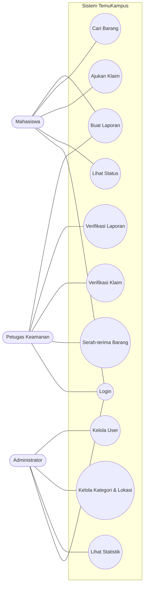
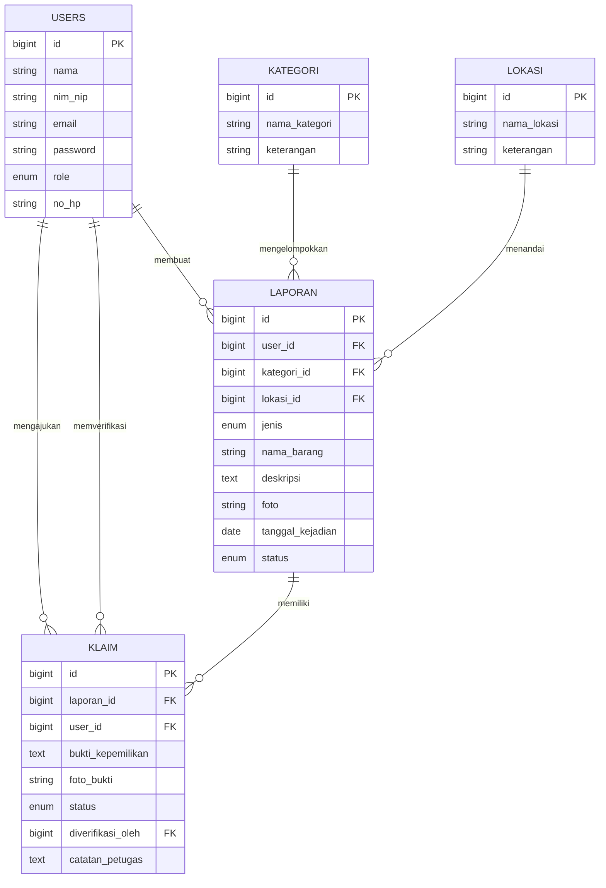

# TemuKampus — Sistem Informasi Lost & Found Kampus

Aplikasi web untuk melaporkan, mencari, dan mengklaim barang hilang atau barang temuan di lingkungan kampus. Dibuat untuk tugas besar **Praktikum Pemrograman Web**.

Tampilan mengikuti desain Figma [TemuKampus — Lost & Found Kampus](https://www.figma.com/design/OVJGxIibCvszqCa92kOauY/TemuKampus-%E2%80%94-Lost---Found-Kampus).

---

## Daftar Isi

1. [Latar Belakang](#1-latar-belakang)
2. [Tujuan](#2-tujuan)
3. [Teknologi](#3-teknologi)
4. [Level Pengguna & Hak Akses](#4-level-pengguna--hak-akses)
5. [Fitur & Aturan Bisnis](#5-fitur--aturan-bisnis)
6. [Alur Sistem](#6-alur-sistem)
7. [Use Case](#7-use-case)
8. [Rancangan Database](#8-rancangan-database)
9. [Struktur Folder](#9-struktur-folder)
10. [Routing](#10-routing)
11. [Endpoint AJAX/JSON](#11-endpoint-ajaxjson)
12. [Halaman (Views)](#12-halaman-views)
13. [Desain](#13-desain)
14. [Instalasi](#14-instalasi)
15. [Akun Demo](#15-akun-demo)
16. [Pengujian](#16-pengujian)
17. [Pembagian Tugas](#17-pembagian-tugas)
18. [Checklist Ketentuan Tugas](#18-checklist-ketentuan-tugas)

---

## 1. Latar Belakang

Barang yang tertinggal di kelas, perpustakaan, masjid, atau kantin kampus sering sulit kembali ke pemiliknya karena:

- **Info tercecer.** Pengumuman hanya lewat grup WhatsApp dan mading, cepat tenggelam oleh pesan lain.
- **Tidak tercatat.** Barang temuan menumpuk di pos satpam tanpa data penemu, waktu, dan lokasi.
- **Rawan salah klaim.** Pengambilan barang tidak disertai verifikasi bukti kepemilikan.

## 2. Tujuan

1. Memusatkan semua laporan barang hilang dan temuan dalam satu sistem.
2. Mempercepat barang kembali ke pemiliknya lewat pencarian yang mudah.
3. Memastikan setiap klaim diverifikasi oleh petugas.

## 3. Teknologi

| Materi | Penggunaan di aplikasi |
|---|---|
| HTML | Struktur halaman lewat Blade template dan komponen Blade (`x-icon`, `x-badge`, `x-logo`, `x-item-card`) |
| CSS | `public/css/style.css`: token warna dan tipografi dari Figma, komponen kustom berawalan `tk-` |
| Bootstrap 5.3 (CDN) | Grid responsif, modal, form, pagination |
| JavaScript / jQuery 3.7 (CDN) | Live search, update status tanpa reload, preview foto, konfirmasi hapus, modal tambah/ubah, grafik dashboard |
| PHP 8.2+ | Bahasa backend |
| Laravel 12 | MVC, routing, Eloquent ORM, migration, seeder, middleware, validasi, feature test |
| AJAX / JSON | Live search barang, verifikasi laporan dan klaim, statistik dashboard |
| MySQL / MariaDB | Database |
| Font | Rubik (judul) dan Nunito Sans (isi), dari Google Fonts |

Grafik dashboard berupa batang CSS yang digambar jQuery dari `/api/statistik`, mengikuti desain Figma. Chart.js tidak dipakai.

## 4. Level Pengguna & Hak Akses

Level disimpan di kolom `role` pada tabel `users`.

| Role | Nilai `role` | Peran |
|---|---|---|
| Administrator | `admin` | Mengelola seluruh data master dan akun |
| Petugas Keamanan (koordinator) | `petugas` | Memverifikasi laporan dan klaim, mengurus serah-terima barang |
| Mahasiswa (pengguna) | `mahasiswa` | Melapor, mencari, dan mengklaim barang |

### Matriks Hak Akses

| Fitur | Admin | Petugas | Mahasiswa |
|---|:-:|:-:|:-:|
| Login / Logout / Edit profil | ✔ | ✔ | ✔ |
| Registrasi akun sendiri | – | – | ✔ |
| Kelola user (CRUD) | ✔ | – | – |
| Kelola kategori (CRUD) | ✔ | – | – |
| Kelola lokasi (CRUD) | ✔ | – | – |
| Lihat daftar laporan | ✔ semua status | ✔ semua status | ✔ hanya yang `aktif` |
| Buat laporan | – | ✔ (langsung `aktif`) | ✔ (status `menunggu`) |
| Edit / hapus laporan sendiri | – | ✔ kapan saja | ✔ selama `menunggu` |
| Hapus laporan apa pun | ✔ | – | – |
| Verifikasi laporan | – | ✔ | – |
| Ajukan klaim | – | – | ✔ |
| Verifikasi klaim | – | ✔ | – |
| Serah-terima (status `dikembalikan`) | – | ✔ | – |
| Dashboard | statistik lengkap | antrean verifikasi | laporan dan klaim sendiri |

Pembatasan dilakukan oleh `RoleMiddleware` di route dan dicek ulang di controller (misalnya pemilik laporan).

## 5. Fitur & Aturan Bisnis

### Administrator
- CRUD akun user dan pengaturan role (tidak bisa menghapus atau menurunkan role akun sendiri)
- CRUD kategori barang dan lokasi kampus (yang masih dipakai laporan tidak bisa dihapus)
- Dashboard statistik: total laporan, menunggu verifikasi, dikembalikan, pengguna; grafik per bulan (6 bulan terakhir) dan per kategori
- Melihat semua laporan dengan filter status, dan menghapus laporan tidak valid atau spam

### Petugas Keamanan
- Dashboard antrean: laporan dan klaim yang menunggu
- Memverifikasi (`aktif`) atau menolak (`ditolak`) laporan
- Memverifikasi atau menolak klaim berdasarkan bukti kepemilikan, dengan catatan petugas
- Serah-terima: menandai barang `dikembalikan` setelah klaim disetujui
- Mencatat barang temuan yang diserahkan langsung ke pos satpam (laporan langsung `aktif`)

### Mahasiswa
- Registrasi dan login
- Membuat laporan barang **hilang** atau **temuan**, lengkap dengan foto (opsional, maksimal 2 MB)
- Mencari barang dengan live search (kata kunci, kategori, lokasi, jenis)
- Mengajukan klaim atas barang temuan beserta bukti kepemilikan
- Memantau status laporan dan klaim milik sendiri

### Status Laporan

| Status | Arti |
|---|---|
| `menunggu` | Laporan baru, belum diverifikasi petugas |
| `aktif` | Sudah diverifikasi dan tampil di daftar publik |
| `diklaim` | Ada klaim yang sedang diproses atau sudah disetujui |
| `dikembalikan` | Barang sudah diserahkan ke pemilik (selesai) |
| `ditolak` | Laporan tidak valid |

### Status Klaim

| Status | Arti |
|---|---|
| `menunggu` | Klaim baru diajukan |
| `disetujui` | Bukti valid, pemilik dijadwalkan mengambil barang |
| `ditolak` | Bukti tidak sesuai |

### Aturan klaim
- Klaim hanya untuk laporan berjenis **temuan** yang berstatus `aktif`.
- Pelapor tidak bisa mengklaim laporannya sendiri.
- Satu mahasiswa tidak bisa mengajukan klaim ganda selama klaim sebelumnya masih `menunggu` atau `disetujui`.
- Bukti kepemilikan minimal 15 karakter.
- Saat klaim diajukan, laporan menjadi `diklaim`. Bila klaim **ditolak** dan tidak ada klaim lain yang berjalan, laporan kembali `aktif`.
- Status `dikembalikan` hanya bisa diberikan pada laporan yang sedang `diklaim`.
- Verifikasi laporan (`aktif` atau `ditolak`) hanya untuk laporan yang masih `menunggu`.

## 6. Alur Sistem

### Alur barang temuan
```
Mahasiswa menemukan barang
  → Buat laporan (jenis: temuan) + foto          [status: menunggu]
  → Petugas memverifikasi laporan               [status: aktif]
  → Pemilik mencari barang lalu mengajukan klaim [klaim: menunggu, laporan: diklaim]
  → Petugas mengecek bukti kepemilikan
        ├─ valid   → klaim disetujui → serah-terima → laporan: dikembalikan
        └─ invalid → klaim ditolak  → laporan kembali: aktif
```

### Alur barang hilang
```
Mahasiswa kehilangan barang
  → Buat laporan (jenis: hilang)                 [status: menunggu]
  → Petugas memverifikasi                        [status: aktif]
  → Penemu melihat laporan, menyerahkan barang ke pos satpam
  → Petugas mencatat barang temuan, menghubungi pemilik → serah-terima
```

## 7. Use Case

| Aktor | Use case |
|---|---|
| Semua aktor | Login, Logout, Edit Profil |
| Mahasiswa | Registrasi, Buat Laporan, Cari Barang, Ajukan Klaim, Lihat Status Laporan dan Klaim |
| Petugas Keamanan | Verifikasi Laporan, Verifikasi Klaim, Serah-terima Barang, Catat Barang Temuan |
| Administrator | Kelola User, Kelola Kategori, Kelola Lokasi, Lihat Statistik, Hapus Laporan |



## 8. Rancangan Database

### ERD



### Relasi

| Relasi | Kardinalitas | Keterangan |
|---|---|---|
| users → laporan | 1 : N | Satu user bisa membuat banyak laporan |
| kategori → laporan | 1 : N | Satu kategori dipakai banyak laporan |
| lokasi → laporan | 1 : N | Satu lokasi dipakai banyak laporan |
| laporan → klaim | 1 : N | Satu laporan bisa diklaim beberapa kali (yang disetujui hanya satu) |
| users → klaim | 1 : N | Mahasiswa yang mengajukan klaim |
| users (petugas) → klaim | 1 : N | Petugas yang memverifikasi (`diverifikasi_oleh`) |

### Kamus Data

**users**

| Kolom | Tipe | Keterangan |
|---|---|---|
| id | BIGINT, PK, AI | |
| nama | VARCHAR(100) | |
| nim_nip | VARCHAR(20), nullable | NIM mahasiswa / NIP petugas |
| email | VARCHAR(100), unique | |
| password | VARCHAR(255) | Hash bcrypt |
| role | ENUM('admin','petugas','mahasiswa') | Default `mahasiswa` |
| no_hp | VARCHAR(20), nullable | |
| remember_token | VARCHAR(100), nullable | Untuk "Ingat saya" |
| created_at, updated_at | TIMESTAMP | |

Migration `users` juga membuat tabel `password_reset_tokens` dan `sessions` (sesi disimpan di database).

**kategori**

| Kolom | Tipe | Keterangan |
|---|---|---|
| id | BIGINT, PK, AI | |
| nama_kategori | VARCHAR(50) | |
| keterangan | VARCHAR(150), nullable | Ada di modal desain Figma |
| created_at, updated_at | TIMESTAMP | |

**lokasi**

| Kolom | Tipe | Keterangan |
|---|---|---|
| id | BIGINT, PK, AI | |
| nama_lokasi | VARCHAR(100) | |
| keterangan | VARCHAR(150), nullable | |
| created_at, updated_at | TIMESTAMP | |

**laporan**

| Kolom | Tipe | Keterangan |
|---|---|---|
| id | BIGINT, PK, AI | |
| user_id | BIGINT, FK → users.id | Pelapor |
| kategori_id | BIGINT, FK → kategori.id | |
| lokasi_id | BIGINT, FK → lokasi.id | |
| jenis | ENUM('hilang','temuan') | |
| nama_barang | VARCHAR(100) | |
| deskripsi | TEXT | Ciri-ciri barang |
| foto | VARCHAR(255), nullable | Path di `storage/app/public/laporan` |
| tanggal_kejadian | DATE | Tidak boleh di masa depan |
| status | ENUM('menunggu','aktif','diklaim','dikembalikan','ditolak') | Default `menunggu` |
| created_at, updated_at | TIMESTAMP | |

**klaim**

| Kolom | Tipe | Keterangan |
|---|---|---|
| id | BIGINT, PK, AI | |
| laporan_id | BIGINT, FK → laporan.id | |
| user_id | BIGINT, FK → users.id | Pengklaim |
| bukti_kepemilikan | TEXT | Ciri khusus, isi barang, dll. |
| foto_bukti | VARCHAR(255), nullable | Path di `storage/app/public/klaim` |
| status | ENUM('menunggu','disetujui','ditolak') | Default `menunggu` |
| diverifikasi_oleh | BIGINT, FK → users.id, nullable | Petugas |
| catatan_petugas | TEXT, nullable | |
| created_at, updated_at | TIMESTAMP | |

### Relasi di Model Eloquent

```php
// app/Models/Laporan.php (ringkas)
public function user()     { return $this->belongsTo(User::class); }
public function kategori() { return $this->belongsTo(Kategori::class); }
public function lokasi()   { return $this->belongsTo(Lokasi::class); }
public function klaim()    { return $this->hasMany(Klaim::class); }

// app/Models/Klaim.php (ringkas)
public function laporan()  { return $this->belongsTo(Laporan::class); }
public function user()     { return $this->belongsTo(User::class); }
public function petugas()  { return $this->belongsTo(User::class, 'diverifikasi_oleh'); }
```

Kolom kunci (`user_id`, `kategori_id`, `lokasi_id`, dst.) di-cast ke `integer` supaya perbandingan `===` aman di semua driver database.

## 9. Struktur Folder

```
temukampus-app/
├── app/
│   ├── Http/
│   │   ├── Controllers/
│   │   │   ├── AuthController.php          # login, register, logout, profil
│   │   │   ├── DashboardController.php     # dashboard 3 role + /api/statistik
│   │   │   ├── LaporanController.php       # beranda, daftar, CRUD, search JSON
│   │   │   ├── KlaimController.php
│   │   │   ├── Admin/
│   │   │   │   ├── UserController.php
│   │   │   │   ├── KategoriController.php
│   │   │   │   └── LokasiController.php
│   │   │   └── Petugas/
│   │   │       └── VerifikasiController.php  # verifikasi, serah-terima, PATCH status
│   │   └── Middleware/
│   │       └── RoleMiddleware.php
│   ├── Models/                              # User, Kategori, Lokasi, Laporan, Klaim
│   └── Providers/AppServiceProvider.php     # pagination Bootstrap 5, locale tanggal id
├── database/
│   ├── migrations/                          # users, kategori, lokasi, laporan, klaim
│   └── seeders/DatabaseSeeder.php           # akun demo + data contoh
├── public/
│   ├── css/style.css
│   ├── js/app.js
│   ├── img/logo-mark.svg                    # logo konsep A (Figma)
│   ├── img/icons/*.svg                      # 20 ikon dari Figma
│   └── favicon.svg
├── resources/views/
│   ├── layouts/        (app, auth, public)
│   ├── partials/       (head, sidebar, flash)
│   ├── components/     (icon, badge, logo, item-card)
│   ├── auth/           (login, register, profil)
│   ├── dashboard/      (admin, petugas, mahasiswa)
│   ├── laporan/        (index, saya, create, edit, show, _form)
│   ├── klaim/          (index, create)
│   ├── admin/          (users, kategori, lokasi, laporan, _master)
│   ├── petugas/        (laporan, klaim, serahterima)
│   └── beranda.blade.php
├── routes/web.php
└── tests/Feature/TemuKampusTest.php
```

## 10. Routing

### Middleware role

```php
// app/Http/Middleware/RoleMiddleware.php
public function handle(Request $request, Closure $next, ...$roles)
{
    if (!auth()->check() || !in_array(auth()->user()->role, $roles)) {
        abort(403, 'Anda tidak punya akses ke halaman ini.');
    }
    return $next($request);
}
```

Middleware dipanggil lewat **nama kelas**, bukan alias, sehingga tidak perlu didaftarkan di `bootstrap/app.php`:

```php
$role = fn (string ...$roles) => RoleMiddleware::class . ':' . implode(',', $roles);

Route::middleware($role('admin'))->prefix('admin')->name('admin.')->group(function () { ... });
```

### Daftar route (`routes/web.php`)

| Akses | Method & URL | Fungsi |
|---|---|---|
| Publik | `GET /` | Beranda: barang temuan terbaru |
| Tamu | `GET/POST /login`, `GET/POST /register` | Autentikasi |
| Login | `POST /logout`, `GET /dashboard`, `GET/PUT /profil` | Sesi, dashboard sesuai role, edit profil |
| Login | `GET /laporan`, `GET /laporan/{laporan}` | Daftar barang (live search) dan detail |
| Petugas, Mahasiswa | `GET /laporan/saya`, `GET /laporan/create`, `POST /laporan`, `GET /laporan/{laporan}/edit`, `PUT` dan `DELETE /laporan/{laporan}` | Laporan milik sendiri |
| Mahasiswa | `GET /klaim`, `GET/POST /laporan/{laporan}/klaim` | Klaim saya, form dan kirim klaim |
| Petugas | `GET /petugas/laporan`, `/petugas/klaim`, `/petugas/serah-terima` | Verifikasi laporan, verifikasi klaim, serah-terima |
| Admin | `/admin/users`, `/admin/kategori`, `/admin/lokasi` (index, store, update, destroy) | Data master |
| Admin | `GET /admin/laporan`, `DELETE /admin/laporan/{laporan}` | Semua laporan, hapus laporan |
| Login | `/api/*` | Lihat bagian 11 |

## 11. Endpoint AJAX/JSON

Semua endpoint ada di bawah middleware `auth`. Request `PATCH` mengirim header `X-CSRF-TOKEN` (disiapkan di `app.js`).

| Method | URL | Role | Fungsi |
|---|---|---|---|
| GET | `/api/laporan/search?q=&kategori=&lokasi=&jenis=&status=` | Semua (login) | Live search barang (maks. 20 hasil) |
| GET | `/api/statistik` | Admin, Petugas | Data grafik dashboard |
| PATCH | `/api/laporan/{id}/status` | Petugas | Verifikasi laporan atau serah-terima |
| PATCH | `/api/klaim/{id}/status` | Petugas | Setujui atau tolak klaim |

### Live search

- Mahasiswa hanya mendapat laporan berstatus `aktif`. Parameter `status` hanya berlaku untuk admin dan petugas.
- Response:
```json
{
  "total": 6,
  "data": [
    { "id": 1, "jenis": "temuan", "nama_barang": "Botol Minum Biru", "status": "aktif",
      "foto_url": null, "tanggal_label": "6 Nov 2026",
      "kategori": { "nama_kategori": "Lainnya" }, "lokasi": { "nama_lokasi": "Perpustakaan" } }
  ]
}
```

### Update status laporan

Body: `status` ∈ `aktif`, `ditolak`, `dikembalikan`.

```json
{ "success": true, "id": 12, "status": "aktif" }
```
Gagal (HTTP 422) bila transisi tidak sah, misalnya memverifikasi laporan yang sudah diproses atau mengembalikan barang yang belum diklaim:
```json
{ "success": false, "message": "Laporan ini sudah diproses." }
```

### Update status klaim

Body: `status` ∈ `disetujui`, `ditolak`; opsional `catatan_petugas` (maks. 500 karakter).

```json
{ "success": true, "id": 5, "status": "ditolak", "laporan_status": "aktif" }
```

### Statistik

```json
{
  "per_bulan":    [ { "label": "Jun", "jumlah": 0 }, "... 6 bulan terakhir ..." ],
  "per_kategori": [ { "nama": "Aksesoris", "jumlah": 3 } ],
  "per_status":   { "aktif": 6, "menunggu": 1 }
}
```

## 12. Halaman (Views)

| Halaman | URL | Role | Isi |
|---|---|---|---|
| Beranda | `/` | Publik | Hero, barang temuan terbaru, tombol masuk dan daftar |
| Login / Register | `/login`, `/register` | Tamu | Form autentikasi (layout dua kolom sesuai Figma) |
| Edit Profil | `/profil` | Semua | Ubah data akun dan password |
| Dashboard Admin | `/dashboard` | Admin | 4 kartu angka, grafik per bulan dan per kategori (AJAX), laporan terbaru |
| Dashboard Petugas | `/dashboard` | Petugas | Antrean laporan dan klaim yang menunggu, siap serah-terima |
| Dashboard Mahasiswa | `/dashboard` | Mahasiswa | Laporan dan klaim milik sendiri beserta statusnya |
| Cari Barang | `/laporan` | Semua | Live search + filter kategori, lokasi, jenis (dan status untuk petugas/admin) |
| Detail Barang | `/laporan/{id}` | Semua | Foto, deskripsi, lokasi, tombol "Klaim barang ini" |
| Laporan Saya | `/laporan/saya` | Petugas, Mahasiswa | Tabel laporan sendiri, ubah dan hapus |
| Form Laporan | `/laporan/create`, `/laporan/{id}/edit` | Petugas, Mahasiswa | Input laporan + preview foto (jQuery) |
| Klaim Saya | `/klaim` | Mahasiswa | Status klaim dan catatan petugas |
| Form Klaim | `/laporan/{id}/klaim` | Mahasiswa | Bukti kepemilikan + foto |
| Verifikasi Laporan | `/petugas/laporan` | Petugas | Tabel laporan `menunggu` + Setujui/Tolak (AJAX) |
| Verifikasi Klaim | `/petugas/klaim` | Petugas | Tab status, tabel klaim, panel detail, Setujui/Tolak (AJAX) |
| Serah-terima | `/petugas/serah-terima` | Petugas | Klaim disetujui + tombol "Tandai dikembalikan" (AJAX) |
| Kelola User | `/admin/users` | Admin | Tabel, filter role, modal tambah/ubah |
| Kelola Kategori / Lokasi | `/admin/kategori`, `/admin/lokasi` | Admin | Tabel CRUD + modal tambah/ubah |
| Semua Laporan | `/admin/laporan` | Admin | Tabel dengan filter status, pagination, hapus |

Tata letak responsif lewat Bootstrap: sidebar menjadi menu geser di layar kecil. Halaman "Mobile App" pada file Figma belum dicocokkan secara terpisah.

## 13. Desain

- **Acuan:** file Figma di bagian atas dokumen. Halaman Figma: *Komponen*, *Mobile App*, *Web*, *Logo*.
- **Token** (variabel CSS di `public/css/style.css`):

| Token | Nilai |
|---|---|
| navy / navy-soft | `#1e2a3a` / `#2b3b52` |
| orange / orange-dark / orange-tint | `#e8833a` / `#b85e1e` / `#fcebdd` |
| bg / surface / border | `#f7f5f0` / `#fffdf9` / `#e2ded5` |
| text / text-muted / text-inverse | `#1e2a3a` / `#5b6577` / `#f7f5f0` |
| green, blue, red, gray | `#2e8b57`, `#2f6fc4`, `#c7453b`, `#5b6577`; tint `#e1f2e8`, `#e3edfa`, `#f8e1df`, `#eeebe4` |

- **Badge:** Jenis: Hilang merah, Temuan biru. Status: Menunggu oranye, Aktif/Disetujui hijau, Diklaim biru, Dikembalikan abu, Ditolak merah (`components/badge.blade.php`).
- **Logo:** konsep A "Pin Cari" (`public/img/logo-mark.svg`), komponen `<x-logo>`, dan favicon `public/favicon.svg`.
- **Ikon:** SVG asli dari Figma di `public/img/icons`, diwarnai lewat CSS mask (`<x-icon name="..." />`).

## 14. Instalasi

**Kebutuhan:** PHP ≥ 8.2 (ekstensi `pdo_mysql`, `mbstring`, `openssl`, `fileinfo`), Composer, MySQL/MariaDB (XAMPP atau Laragon). Node.js tidak diperlukan karena Bootstrap, jQuery, dan font dimuat dari CDN (butuh koneksi internet).

```bash
# 1. Ambil kode
git clone https://github.com/FlaminggoZer0ne/temukampus.git
cd temukampus

# 2. Install dependency
composer install

# 3. Salin file environment dan buat app key
cp .env.example .env
php artisan key:generate
```

Buat database `temukampus` (phpMyAdmin atau `CREATE DATABASE temukampus CHARACTER SET utf8mb4 COLLATE utf8mb4_unicode_ci;`), lalu cek koneksi di `.env`:

```env
APP_LOCALE=id
DB_CONNECTION=mysql
DB_HOST=127.0.0.1
DB_PORT=3306
DB_DATABASE=temukampus
DB_USERNAME=root
DB_PASSWORD=          # isi bila MySQL Anda memakai password
```

```bash
# 4. Buat tabel dan data contoh
php artisan migrate --seed

# 5. Link folder upload foto
php artisan storage:link

# 6. Jalankan server
php artisan serve
```

Buka `http://127.0.0.1:8000`.

Di Windows dengan XAMPP, bila `php` tidak dikenali, panggil lewat path lengkap, misalnya `C:\xampp\php\php.exe artisan serve`. Server berhenti saat jendela terminal ditutup.

Zona waktu aplikasi diatur ke `Asia/Jakarta` di `config/app.php`.

## 15. Akun Demo

Dibuat otomatis oleh `DatabaseSeeder`, bersama 5 kategori, 6 lokasi, 9 laporan contoh, dan 1 klaim menunggu.

| Role | Nama | Email | Password |
|---|---|---|---|
| Administrator | Admin Kampus | admin@temukampus.test | password |
| Petugas Keamanan | Pak Joko | petugas@temukampus.test | password |
| Mahasiswa | Mahasiswa Demo | mahasiswa@temukampus.test | password |
| Mahasiswa | Andi Pratama | andi@temukampus.test | password |

Akun Andi dipakai sebagai pengklaim pada klaim contoh "Kunci Motor Honda". Ganti atau hapus akun demo bila aplikasi dipublikasikan.

## 16. Pengujian

Feature test ada di `tests/Feature/TemuKampusTest.php` (9 test). Test memakai SQLite in-memory (lihat `phpunit.xml`), jadi tidak menyentuh database MySQL dan membutuhkan ekstensi `pdo_sqlite`.

```bash
php artisan test
```

Yang diuji:
- Halaman publik, login, dan registrasi
- Semua halaman utama dirender tanpa error untuk tiap role
- Pembatasan akses antar role (403)
- Live search dan pembatasan mahasiswa ke laporan `aktif`
- Alur lengkap: lapor dengan foto → verifikasi → klaim → tolak → klaim ulang → setujui → serah-terima
- Aturan edit dan hapus laporan, laporan petugas langsung `aktif`
- CRUD admin (kategori, lokasi, user) dan perlindungan data yang masih dipakai
- Bentuk JSON `/api/statistik`

## 17. Pembagian Tugas

Isi sesuai anggota kelompok.

| Nama | Peran | Tugas |
|---|---|---|
| [Nama Anggota 1] | Ketua & Backend | Setup Laravel, autentikasi, middleware 3 level user, CRUD laporan |
| [Nama Anggota 2] | Backend & Database | Migration, seeder, relasi model, fitur klaim & verifikasi |
| [Nama Anggota 3] | Frontend | Layout Blade + Bootstrap, halaman responsif, form-form |
| [Nama Anggota 4] | JavaScript & Dokumentasi | Live search & update status (jQuery AJAX/JSON), grafik dashboard, testing, slide |

## 18. Checklist Ketentuan Tugas

- [x] Topik bebas: Lost & Found Kampus
- [x] Database MySQL dengan 5 tabel berelasi
- [x] CRUD lengkap: user, kategori, lokasi, laporan, klaim
- [x] 3 level pengguna: Administrator, Petugas Keamanan (koordinator), Mahasiswa (pengguna)
- [x] HTML & CSS: Blade template + `style.css`
- [x] Bootstrap: layout, komponen, responsif
- [x] JavaScript/jQuery: preview foto, konfirmasi hapus, AJAX
- [x] PHP & Laravel: MVC, Eloquent, migration, middleware, validasi
- [x] AJAX/JSON: live search, update status, statistik dashboard
