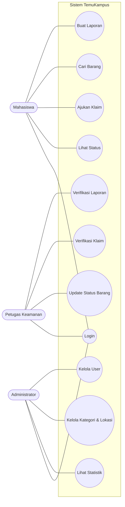
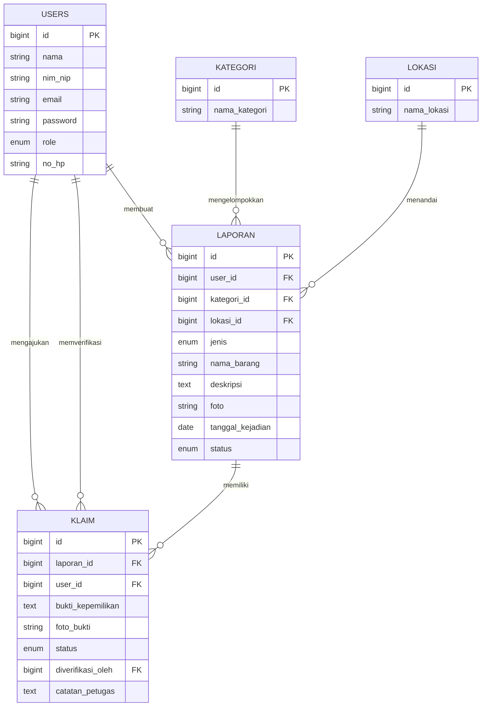

# TemuKampus — Sistem Informasi Lost & Found Kampus

Aplikasi web untuk melaporkan, mencari, dan mengklaim barang hilang atau barang temuan di lingkungan kampus. Dibuat untuk tugas besar **Praktikum Pemrograman Web**.

---

## Daftar Isi

1. [Latar Belakang](#1-latar-belakang)
2. [Tujuan](#2-tujuan)
3. [Teknologi](#3-teknologi)
4. [Level Pengguna & Hak Akses](#4-level-pengguna--hak-akses)
5. [Fitur](#5-fitur)
6. [Alur Sistem](#6-alur-sistem)
7. [Use Case](#7-use-case)
8. [Rancangan Database](#8-rancangan-database)
9. [Struktur Folder](#9-struktur-folder)
10. [Routing](#10-routing)
11. [Endpoint AJAX/JSON](#11-endpoint-ajaxjson)
12. [Halaman (Views)](#12-halaman-views)
13. [Instalasi](#13-instalasi)
14. [Akun Demo](#14-akun-demo)
15. [Pembagian Tugas](#15-pembagian-tugas)
16. [Checklist Ketentuan Tugas](#16-checklist-ketentuan-tugas)

---

## 1. Latar Belakang

Barang yang tertinggal di kelas, perpustakaan, masjid, atau kantin kampus sering sulit kembali ke pemiliknya karena:

- **Info tercecer.** Pengumuman hanya lewat grup WhatsApp dan mading, cepat tenggelam oleh pesan lain.
- **Tidak tercatat.** Barang temuan menumpuk di pos satpam tanpa data penemu, waktu, dan lokasi.
- **Rawan salah klaim.** Pengambilan barang tidak disertai verifikasi bukti kepemilikan.

## 2. Tujuan

1. Memusatkan semua laporan barang hilang dan temuan dalam satu sistem.
2. Mempercepat barang kembali ke pemiliknya lewat pencarian yang mudah.
3. Memastikan setiap klaim diverifikasi oleh petugas.

## 3. Teknologi

| Materi | Penggunaan di aplikasi |
|---|---|
| HTML | Struktur halaman lewat Blade template |
| CSS | Styling tambahan (`public/css/style.css`) |
| Bootstrap 5 | Layout responsif, navbar, card, tabel, form, modal, badge status |
| JavaScript / jQuery | Preview foto sebelum upload, konfirmasi hapus, request AJAX |
| PHP | Bahasa backend |
| Laravel 10/11 | MVC, routing, Eloquent ORM, migration, seeder, middleware, validasi |
| AJAX / JSON | Live search barang, update status tanpa reload, statistik dashboard |
| MySQL | Database |

## 4. Level Pengguna & Hak Akses

Level disimpan di kolom `role` pada tabel `users`.

| Role | Nilai `role` | Peran |
|---|---|---|
| Administrator | `admin` | Mengelola seluruh data master dan akun |
| Petugas Keamanan (koordinator) | `petugas` | Memverifikasi laporan dan klaim, mengurus serah-terima barang |
| Mahasiswa (pengguna) | `mahasiswa` | Melapor, mencari, dan mengklaim barang |

### Matriks Hak Akses

| Fitur | Admin | Petugas | Mahasiswa |
|---|:-:|:-:|:-:|
| Login / Logout / Edit profil | ✔ | ✔ | ✔ |
| Registrasi akun sendiri | – | – | ✔ |
| Kelola user (CRUD) | ✔ | – | – |
| Kelola kategori (CRUD) | ✔ | – | – |
| Kelola lokasi (CRUD) | ✔ | – | – |
| Lihat semua laporan | ✔ | ✔ | ✔ (yang sudah diverifikasi) |
| Buat laporan | – | ✔ | ✔ |
| Edit / hapus laporan sendiri | – | ✔ | ✔ (selama status `menunggu`) |
| Hapus laporan apa pun | ✔ | – | – |
| Verifikasi laporan | – | ✔ | – |
| Ajukan klaim | – | – | ✔ |
| Verifikasi klaim | – | ✔ | – |
| Update status barang | – | ✔ | – |
| Dashboard statistik | ✔ | ✔ (ringkas) | ✔ (laporan sendiri) |

## 5. Fitur

### Administrator
- CRUD akun user dan pengaturan role
- CRUD kategori barang (Elektronik, Dokumen, Aksesoris, Pakaian, Lainnya)
- CRUD lokasi kampus (Gedung A, Perpustakaan, Masjid, Kantin, dll.)
- Dashboard statistik: jumlah laporan per status, per kategori, dan per bulan (data dari AJAX/JSON)
- Menghapus laporan yang tidak valid atau spam

### Petugas Keamanan
- Melihat laporan baru yang berstatus `menunggu`
- Memverifikasi atau menolak laporan
- Memverifikasi atau menolak klaim berdasarkan bukti kepemilikan
- Mengubah status barang menjadi `dikembalikan` saat serah-terima
- Mencatat barang temuan yang diserahkan langsung ke pos satpam

### Mahasiswa
- Registrasi dan login
- Membuat laporan barang **hilang** atau **temuan**, lengkap dengan foto
- Mencari barang dengan live search (kata kunci, kategori, lokasi, jenis)
- Mengajukan klaim atas barang temuan beserta bukti kepemilikan
- Memantau status laporan dan klaim milik sendiri

### Status Laporan

| Status | Arti |
|---|---|
| `menunggu` | Laporan baru, belum diverifikasi petugas |
| `aktif` | Sudah diverifikasi dan tampil di daftar publik |
| `diklaim` | Ada klaim yang sedang diproses |
| `dikembalikan` | Barang sudah diserahkan ke pemilik (selesai) |
| `ditolak` | Laporan tidak valid |

### Status Klaim

| Status | Arti |
|---|---|
| `menunggu` | Klaim baru diajukan |
| `disetujui` | Bukti valid, pemilik dijadwalkan mengambil barang |
| `ditolak` | Bukti tidak sesuai |

## 6. Alur Sistem

### Alur barang temuan
```
Mahasiswa menemukan barang
  → Buat laporan (jenis: temuan) + foto         [status: menunggu]
  → Petugas memverifikasi laporan              [status: aktif]
  → Pemilik mencari barang lalu mengajukan klaim [klaim: menunggu, laporan: diklaim]
  → Petugas mengecek bukti kepemilikan
        ├─ valid   → klaim disetujui → serah-terima → laporan: dikembalikan
        └─ invalid → klaim ditolak  → laporan kembali: aktif
```

### Alur barang hilang
```
Mahasiswa kehilangan barang
  → Buat laporan (jenis: hilang)                [status: menunggu]
  → Petugas memverifikasi                       [status: aktif]
  → Penemu melihat laporan, menyerahkan barang ke pos satpam
  → Petugas menghubungi pemilik → serah-terima  [status: dikembalikan]
```

## 7. Use Case

| Aktor | Use case |
|---|---|
| Semua aktor | Login, Logout, Edit Profil |
| Mahasiswa | Registrasi, Buat Laporan, Cari Barang, Ajukan Klaim, Lihat Status Laporan |
| Petugas Keamanan | Verifikasi Laporan, Verifikasi Klaim, Update Status Barang |
| Administrator | Kelola User, Kelola Kategori, Kelola Lokasi, Lihat Statistik |



## 8. Rancangan Database

### ERD



### Relasi

| Relasi | Kardinalitas | Keterangan |
|---|---|---|
| users → laporan | 1 : N | Satu user bisa membuat banyak laporan |
| kategori → laporan | 1 : N | Satu kategori dipakai banyak laporan |
| lokasi → laporan | 1 : N | Satu lokasi dipakai banyak laporan |
| laporan → klaim | 1 : N | Satu laporan bisa diklaim beberapa kali (yang disetujui hanya satu) |
| users → klaim | 1 : N | Mahasiswa yang mengajukan klaim |
| users (petugas) → klaim | 1 : N | Petugas yang memverifikasi (`diverifikasi_oleh`) |

### Kamus Data

**users**

| Kolom | Tipe | Keterangan |
|---|---|---|
| id | BIGINT, PK, AI | |
| nama | VARCHAR(100) | |
| nim_nip | VARCHAR(20), nullable | NIM mahasiswa / NIP petugas |
| email | VARCHAR(100), unique | |
| password | VARCHAR(255) | Hash bcrypt |
| role | ENUM('admin','petugas','mahasiswa') | Default `mahasiswa` |
| no_hp | VARCHAR(20), nullable | |
| created_at, updated_at | TIMESTAMP | |

**kategori**

| Kolom | Tipe | Keterangan |
|---|---|---|
| id | BIGINT, PK, AI | |
| nama_kategori | VARCHAR(50) | |
| created_at, updated_at | TIMESTAMP | |

**lokasi**

| Kolom | Tipe | Keterangan |
|---|---|---|
| id | BIGINT, PK, AI | |
| nama_lokasi | VARCHAR(100) | |
| created_at, updated_at | TIMESTAMP | |

**laporan**

| Kolom | Tipe | Keterangan |
|---|---|---|
| id | BIGINT, PK, AI | |
| user_id | BIGINT, FK → users.id | Pelapor |
| kategori_id | BIGINT, FK → kategori.id | |
| lokasi_id | BIGINT, FK → lokasi.id | |
| jenis | ENUM('hilang','temuan') | |
| nama_barang | VARCHAR(100) | |
| deskripsi | TEXT | Ciri-ciri barang |
| foto | VARCHAR(255), nullable | Path di `storage/app/public/laporan` |
| tanggal_kejadian | DATE | |
| status | ENUM('menunggu','aktif','diklaim','dikembalikan','ditolak') | Default `menunggu` |
| created_at, updated_at | TIMESTAMP | |

**klaim**

| Kolom | Tipe | Keterangan |
|---|---|---|
| id | BIGINT, PK, AI | |
| laporan_id | BIGINT, FK → laporan.id | |
| user_id | BIGINT, FK → users.id | Pengklaim |
| bukti_kepemilikan | TEXT | Ciri khusus, isi barang, dll. |
| foto_bukti | VARCHAR(255), nullable | Misal foto lama bersama barang |
| status | ENUM('menunggu','disetujui','ditolak') | Default `menunggu` |
| diverifikasi_oleh | BIGINT, FK → users.id, nullable | Petugas |
| catatan_petugas | TEXT, nullable | |
| created_at, updated_at | TIMESTAMP | |

### Contoh Migration (laporan)

```php
Schema::create('laporan', function (Blueprint $table) {
    $table->id();
    $table->foreignId('user_id')->constrained('users')->cascadeOnDelete();
    $table->foreignId('kategori_id')->constrained('kategori');
    $table->foreignId('lokasi_id')->constrained('lokasi');
    $table->enum('jenis', ['hilang', 'temuan']);
    $table->string('nama_barang', 100);
    $table->text('deskripsi');
    $table->string('foto')->nullable();
    $table->date('tanggal_kejadian');
    $table->enum('status', ['menunggu', 'aktif', 'diklaim', 'dikembalikan', 'ditolak'])
          ->default('menunggu');
    $table->timestamps();
});
```

### Contoh Migration (klaim)

```php
Schema::create('klaim', function (Blueprint $table) {
    $table->id();
    $table->foreignId('laporan_id')->constrained('laporan')->cascadeOnDelete();
    $table->foreignId('user_id')->constrained('users')->cascadeOnDelete();
    $table->text('bukti_kepemilikan');
    $table->string('foto_bukti')->nullable();
    $table->enum('status', ['menunggu', 'disetujui', 'ditolak'])->default('menunggu');
    $table->foreignId('diverifikasi_oleh')->nullable()->constrained('users')->nullOnDelete();
    $table->text('catatan_petugas')->nullable();
    $table->timestamps();
});
```

### Relasi di Model Eloquent

```php
// app/Models/Laporan.php
class Laporan extends Model
{
    protected $table = 'laporan';
    protected $fillable = ['user_id', 'kategori_id', 'lokasi_id', 'jenis',
                           'nama_barang', 'deskripsi', 'foto', 'tanggal_kejadian', 'status'];

    public function user()     { return $this->belongsTo(User::class); }
    public function kategori() { return $this->belongsTo(Kategori::class); }
    public function lokasi()   { return $this->belongsTo(Lokasi::class); }
    public function klaim()    { return $this->hasMany(Klaim::class); }
}

// app/Models/Klaim.php
class Klaim extends Model
{
    protected $table = 'klaim';
    protected $fillable = ['laporan_id', 'user_id', 'bukti_kepemilikan',
                           'foto_bukti', 'status', 'diverifikasi_oleh', 'catatan_petugas'];

    public function laporan()  { return $this->belongsTo(Laporan::class); }
    public function user()     { return $this->belongsTo(User::class); }
    public function petugas()  { return $this->belongsTo(User::class, 'diverifikasi_oleh'); }
}
```

## 9. Struktur Folder

```
temukampus/
├── app/
│   ├── Http/
│   │   ├── Controllers/
│   │   │   ├── AuthController.php
│   │   │   ├── DashboardController.php
│   │   │   ├── LaporanController.php
│   │   │   ├── KlaimController.php
│   │   │   ├── Admin/
│   │   │   │   ├── UserController.php
│   │   │   │   ├── KategoriController.php
│   │   │   │   └── LokasiController.php
│   │   │   └── Petugas/
│   │   │       └── VerifikasiController.php
│   │   └── Middleware/
│   │       └── RoleMiddleware.php
│   └── Models/
│       ├── User.php
│       ├── Kategori.php
│       ├── Lokasi.php
│       ├── Laporan.php
│       └── Klaim.php
├── database/
│   ├── migrations/
│   └── seeders/
│       └── DatabaseSeeder.php
├── public/
│   ├── css/style.css
│   └── js/app.js
├── resources/views/
│   ├── layouts/app.blade.php
│   ├── auth/ (login, register)
│   ├── dashboard/ (admin, petugas, mahasiswa)
│   ├── laporan/ (index, create, edit, show)
│   ├── klaim/ (index, create)
│   ├── admin/ (users, kategori, lokasi)
│   └── petugas/ (laporan, klaim)
└── routes/web.php
```

## 10. Routing

### Middleware Role

```php
// app/Http/Middleware/RoleMiddleware.php
public function handle(Request $request, Closure $next, ...$roles)
{
    if (!auth()->check() || !in_array(auth()->user()->role, $roles)) {
        abort(403, 'Anda tidak punya akses ke halaman ini.');
    }
    return $next($request);
}
```

Daftarkan alias `role` di `bootstrap/app.php` (Laravel 11) atau `app/Http/Kernel.php` (Laravel 10).

### routes/web.php

```php
// Publik
Route::get('/', [LaporanController::class, 'beranda'])->name('beranda');
Route::get('/login', [AuthController::class, 'showLogin'])->name('login');
Route::post('/login', [AuthController::class, 'login']);
Route::get('/register', [AuthController::class, 'showRegister'])->name('register');
Route::post('/register', [AuthController::class, 'register']);

Route::middleware('auth')->group(function () {
    Route::post('/logout', [AuthController::class, 'logout'])->name('logout');
    Route::get('/dashboard', [DashboardController::class, 'index'])->name('dashboard');

    // Laporan (petugas & mahasiswa)
    Route::resource('laporan', LaporanController::class)
         ->middleware('role:petugas,mahasiswa')->except(['index', 'show']);
    Route::get('/laporan', [LaporanController::class, 'index'])->name('laporan.index');
    Route::get('/laporan/{laporan}', [LaporanController::class, 'show'])->name('laporan.show');

    // Mahasiswa
    Route::middleware('role:mahasiswa')->group(function () {
        Route::get('/klaim', [KlaimController::class, 'index'])->name('klaim.index');
        Route::get('/laporan/{laporan}/klaim', [KlaimController::class, 'create'])->name('klaim.create');
        Route::post('/laporan/{laporan}/klaim', [KlaimController::class, 'store'])->name('klaim.store');
    });

    // Petugas
    Route::middleware('role:petugas')->prefix('petugas')->name('petugas.')->group(function () {
        Route::get('/laporan', [VerifikasiController::class, 'laporan'])->name('laporan');
        Route::get('/klaim', [VerifikasiController::class, 'klaim'])->name('klaim');
    });

    // Admin
    Route::middleware('role:admin')->prefix('admin')->name('admin.')->group(function () {
        Route::resource('users', UserController::class);
        Route::resource('kategori', KategoriController::class);
        Route::resource('lokasi', LokasiController::class);
        Route::delete('/laporan/{laporan}', [LaporanController::class, 'adminDestroy'])->name('laporan.destroy');
    });

    // Endpoint AJAX
    Route::prefix('api')->group(function () {
        Route::get('/laporan/search', [LaporanController::class, 'search']);
        Route::get('/statistik', [DashboardController::class, 'statistik'])->middleware('role:admin,petugas');
        Route::patch('/laporan/{laporan}/status', [VerifikasiController::class, 'updateStatusLaporan'])->middleware('role:petugas');
        Route::patch('/klaim/{klaim}/status', [VerifikasiController::class, 'updateStatusKlaim'])->middleware('role:petugas');
    });
});
```

## 11. Endpoint AJAX/JSON

| Method | URL | Role | Fungsi |
|---|---|---|---|
| GET | `/api/laporan/search?q=&kategori=&lokasi=&jenis=` | Semua (login) | Live search barang |
| GET | `/api/statistik` | Admin, Petugas | Data grafik dashboard |
| PATCH | `/api/laporan/{id}/status` | Petugas | Verifikasi / ubah status laporan |
| PATCH | `/api/klaim/{id}/status` | Petugas | Setujui / tolak klaim |

### Contoh: Live Search

**Controller**
```php
public function search(Request $request)
{
    $data = Laporan::with(['kategori', 'lokasi'])
        ->where('status', 'aktif')
        ->when($request->q, fn($q) => $q->where('nama_barang', 'like', "%{$request->q}%"))
        ->when($request->kategori, fn($q) => $q->where('kategori_id', $request->kategori))
        ->when($request->lokasi, fn($q) => $q->where('lokasi_id', $request->lokasi))
        ->when($request->jenis, fn($q) => $q->where('jenis', $request->jenis))
        ->latest()->limit(20)->get();

    return response()->json($data);
}
```

**jQuery**
```js
$('#cari').on('keyup', function () {
    $.get('/api/laporan/search', { q: $(this).val() }, function (data) {
        let html = '';
        data.forEach(function (item) {
            html += `<div class="col-md-4 mb-3">
                       <div class="card">
                         <div class="card-body">
                           <h5>${item.nama_barang}</h5>
                           <span class="badge bg-info">${item.jenis}</span>
                           <p class="small mb-0">${item.lokasi.nama_lokasi}</p>
                         </div>
                       </div>
                     </div>`;
        });
        $('#hasil').html(html || '<p>Barang tidak ditemukan.</p>');
    });
});
```

### Contoh: Update Status Tanpa Reload

```js
$('.btn-verifikasi').on('click', function () {
    let id = $(this).data('id');
    $.ajax({
        url: '/api/laporan/' + id + '/status',
        type: 'PATCH',
        data: { status: 'aktif', _token: $('meta[name="csrf-token"]').attr('content') },
        success: function (res) {
            $('#status-' + id).text(res.status).attr('class', 'badge bg-success');
        }
    });
});
```

**Response JSON**
```json
{ "success": true, "id": 12, "status": "aktif" }
```

## 12. Halaman (Views)

| Halaman | Role | Isi |
|---|---|---|
| Beranda | Publik | Daftar barang temuan terbaru + tombol login |
| Login / Register | Publik | Form autentikasi |
| Dashboard Admin | Admin | Kartu jumlah user, laporan, klaim + grafik (Chart.js via AJAX) |
| Dashboard Petugas | Petugas | Jumlah laporan & klaim yang menunggu verifikasi |
| Dashboard Mahasiswa | Mahasiswa | Laporan dan klaim milik sendiri beserta statusnya |
| Daftar Barang | Semua | Live search + filter kategori, lokasi, jenis |
| Detail Barang | Semua | Foto, deskripsi, lokasi, tombol "Klaim Barang Ini" |
| Form Laporan | Petugas, Mahasiswa | Input laporan + preview foto (jQuery) |
| Form Klaim | Mahasiswa | Input bukti kepemilikan + foto |
| Verifikasi Laporan | Petugas | Tabel laporan `menunggu` + tombol Setujui/Tolak (AJAX) |
| Verifikasi Klaim | Petugas | Tabel klaim + tombol Setujui/Tolak (AJAX) |
| Kelola User / Kategori / Lokasi | Admin | Tabel CRUD + modal tambah/edit |

## 13. Instalasi

**Kebutuhan:** PHP ≥ 8.1, Composer, MySQL/MariaDB (XAMPP/Laragon), Node.js (opsional).

```bash
# 1. Clone / salin project
git clone <url-repo> temukampus
cd temukampus

# 2. Install dependency
composer install

# 3. Salin file environment
cp .env.example .env
php artisan key:generate
```

Atur koneksi database di `.env`:
```env
DB_CONNECTION=mysql
DB_HOST=127.0.0.1
DB_PORT=3306
DB_DATABASE=temukampus
DB_USERNAME=root
DB_PASSWORD=
```

```bash
# 4. Buat database "temukampus" di phpMyAdmin, lalu:
php artisan migrate --seed

# 5. Link folder upload foto
php artisan storage:link

# 6. Jalankan server
php artisan serve
```

Buka `http://127.0.0.1:8000`.

## 14. Akun Demo

Dibuat otomatis oleh `DatabaseSeeder`.

| Role | Email | Password |
|---|---|---|
| Administrator | admin@temukampus.test | password |
| Petugas Keamanan | petugas@temukampus.test | password |
| Mahasiswa | mahasiswa@temukampus.test | password |

```php
// database/seeders/DatabaseSeeder.php
User::create(['nama' => 'Admin', 'email' => 'admin@temukampus.test',
              'password' => bcrypt('password'), 'role' => 'admin']);
User::create(['nama' => 'Pak Satpam', 'email' => 'petugas@temukampus.test',
              'password' => bcrypt('password'), 'role' => 'petugas']);
User::create(['nama' => 'Mahasiswa Demo', 'email' => 'mahasiswa@temukampus.test',
              'password' => bcrypt('password'), 'role' => 'mahasiswa']);

foreach (['Elektronik', 'Dokumen', 'Aksesoris', 'Pakaian', 'Lainnya'] as $k) {
    Kategori::create(['nama_kategori' => $k]);
}
foreach (['Gedung A', 'Gedung B', 'Perpustakaan', 'Masjid', 'Kantin', 'Parkiran'] as $l) {
    Lokasi::create(['nama_lokasi' => $l]);
}
```

## 15. Pembagian Tugas

| Nama | Peran | Tugas |
|---|---|---|
| [Nama Anggota 1] | Ketua & Backend | Setup Laravel, autentikasi, middleware 3 level user, CRUD laporan |
| [Nama Anggota 2] | Backend & Database | Migration, seeder, relasi model, fitur klaim & verifikasi |
| [Nama Anggota 3] | Frontend | Layout Blade + Bootstrap, halaman responsif, form-form |
| [Nama Anggota 4] | JavaScript & Dokumentasi | Live search & update status (jQuery AJAX/JSON), grafik dashboard, testing, slide |

## 16. Checklist Ketentuan Tugas

- [x] Topik bebas: Lost & Found Kampus
- [x] Database MySQL dengan 5 tabel berelasi
- [x] CRUD lengkap: user, kategori, lokasi, laporan, klaim
- [x] 3 level pengguna: Administrator, Petugas Keamanan (koordinator), Mahasiswa (pengguna)
- [x] HTML & CSS: Blade template + `style.css`
- [x] Bootstrap: layout, komponen, responsif
- [x] JavaScript/jQuery: preview foto, konfirmasi hapus, AJAX
- [x] PHP & Laravel: MVC, Eloquent, migration, middleware, validasi
- [x] AJAX/JSON: live search, update status, statistik dashboard
